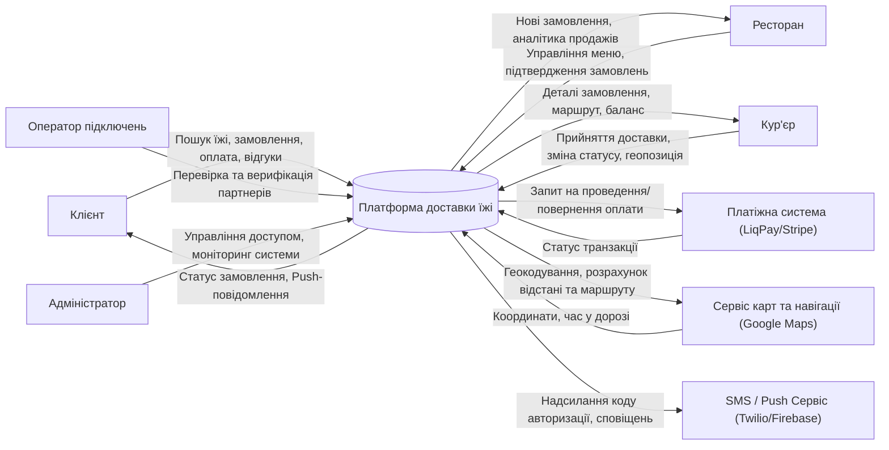

# Опис предметної області, стейкхолдери та вимоги до системи

---

## 1. Опис предметної області

Платформа доставки їжі — це тристоронній маркетплейс, який об'єднує **клієнтів** (замовників їжі), **ресторани** (заклади харчування) та **кур'єрів** (виконавців доставки). Основна мета сервісу — забезпечити швидкий, прозорий та надійний процес від моменту вибору страви до її отримання замовником.

### Як працює сервіс:
1. **Вибір та замовлення:** Клієнт відкриває застосунок чи сайт, переглядає меню доступних ресторанів неподалік, формує кошик, обирає спосіб оплати (карткою або готівкою) та підтверджує замовлення.
2. **Прийняття та приготування:** Ресторан отримує повідомлення про нове замовлення через свій інтерфейс, підтверджує його та починає готувати страви.
3. **Призначення та доставка:** Система шукає найближчого вільного кур'єра. Кур'єр отримує сповіщення, прямує до ресторану, забирає готове замовлення та доставляє його за адресою клієнта.
4. **Завершення:** Клієнт отримує замовлення, підтверджує успішну доставку та може залишити оцінку й відгук про ресторан і кур'єра.

---

## 2. Перелік учасників (стейкхолдерів)

* **Клієнт (Замовник):** Фізична особа, яка замовляє їжу через вебсайт або мобільний застосунок. Зацікавлений у широкому виборі, швидкій доставці, гарячій їжі та зручній оплаті.
* **Ресторан (Партнер):** Заклад громадського харчування. Зацікавлений у збільшенні продажів, своєчасному заборі замовлень кур'єрами та зручному інструменті управління меню і замовленнями.
* **Кур'єр:** Виконавець доставки (піший, на вело/мото або авто). Зацікавлений у стабільному доході, прозорій системі виплат та зручній навігації.
* **Оператор підключень (Менеджер з роботи з партнерами):** Співробітник компанії, який відповідає за підключення нових ресторанів і кур'єрів, перевірку їхніх документів та первинну підтримку.
* **Адміністратор (Системний адміністратор / Служба підтримки):** Співробітник, який контролює загальний стан платформи, вирішує спірні ситуації, керує правами доступу та налаштуваннями системи.

---

## 3. Матриця "Влада — Інтерес" (Power / Interest Grid)

Матриця допомагає зрозуміти, як взаємодіяти з різними групами стейкхолдерів залежно від їхнього рівня впливу на проєкт та зацікавленості в ньому.

| Стейкхолдер | Рівень влади (Power) | Рівень інтересу (Interest) | Категорія стратегії | Пояснення |
| :--- | :--- | :--- | :--- | :--- |
| **Клієнт** | Високий | Високий | **Ключові гравці (Manage Closely)** | Від їхнього задоволення залежить успіх бізнесу. Відтік клієнтів руйнує платформу. |
| **Ресторан** | Високий | Високий | **Ключові гравці (Manage Closely)** | Забезпечують асортимент. Без якісних партнерів платформа втрачає цінність. |
| **Адміністратор** | Високий | Низький | **Задовольняти (Keep Satisfied)** | Має технічну владу над системою, але працює за інструкціями бізнесу. |
| **Кур'єр** | Середній | Високий | **Тримати в курсі (Keep Informed)** | Зацікавлені в стабільності та виплатах, але окремий кур'єр має незначний вплив на систему. |
| **Оператор підключень** | Низький | Середній | **Моніторити (Monitor)** | Виконує операційну роботу з реєстрації партнерів за стандартними регламентами. |

---

## 4. Контекстна діаграма системи (Business Context Diagram)

---

## 5. Функціональні вимоги (User Stories)

### US-01: Реєстрація клієнта
* **Як** новий клієнт,
* **Я хочу** зареєструватися за номером телефону,
* **Щоб** швидко створити обліковий запис і робити замовлення.
  * **Критерії прийняття:**
    * **Дано:** Клієнт знаходиться на екрані реєстрації.
    * **Якщо:** Клієнт вводить коректний номер телефону та натискає "Отримати код".
    * **То:** Система надсилає SMS із 4-значним кодом і перенаправляє на екран підтвердження.

### US-02: Пошук закладу за адресою
* **Як** клієнт,
* **Я хочу** ввести свою адресу доставки,
* **Щоб** побачити список доступних ресторанів поруч зі мною.
  * **Критерії прийняття:**
    * **Дано:** Клієнт вказав адресу "вул. Хрещатик, 1".
    * **Якщо:** Клієнт відкриває головний екран.
    * **То:** Система відображає лише ті ресторани, чий радіус доставки покриває вказану адресу.

### US-03: Фільтрація та сортування меню
* **Як** клієнт,
* **Я хочу** фільтрувати ресторани за категоріями (наприклад, "Суші", "Піца", "Веган"),
* **Щоб** швидко знайти бажану їжу.
  * **Критерії прийняття:**
    * **Дано:** Клієнт знаходиться у каталозі ресторанів.
    * **Якщо:** Клієнт обирає фільтр "Піца".
    * **То:** Система відображає список ресторанів, які мають у меню позиції з категорії "Піца".

### US-04: Додавання позицій у кошик
* **Як** клієнт,
* **Я хочу** додавати страви та їх опції (наприклад, соус чи розмір) у кошик,
* **Щоб** сформувати замовлення.
  * **Критерії прийняття:**
    * **Дано:** Клієнт переглядає картку страви з вибором розміру.
    * **Якщо:** Клієнт обирає розмір "Велика" та натискає "Додати в кошик".
    * **То:** Товар з'являється у кошику з урахуванням обраної опції та відповідною ціною.

### US-05: Онлайн-оплата замовлення
* **Як** клієнт,
* **Я хочу** оплатити замовлення банківською карткою в застосунку,
* **Щоб** не витрачати час на розрахунок готівкою при отриманні.
  * **Критерії прийняття:**
    * **Дано:** Клієнт знаходиться на екрані оформлення замовлення.
    * **Якщо:** Клієнт обирає оплату карткою та успішно підтверджує транзакцію.
    * **То:** Система змінює статус замовлення на "Оплачено" та передає його в ресторан.

### US-06: Відстеження замовлення на карті
* **Як** клієнт,
* **Я хочу** бачити переміщення кур'єра на карті в реальному часі,
* **Щоб** знати точно, коли прибуде їжа.
  * **Критерії прийняття:**
    * **Дано:** Замовлення передано кур'єру.
    * **Якщо:** Клієнт відкриває екран деталізації замовлення.
    * **То:** На карті відображається поточне місцезнаходження кур'єра, яке оновлюється кожні 10 секунд.

### US-07: Управління стоп-листом в ресторані
* **Як** менеджер ресторану,
* **Я можу** тимчасово вимикати страви (переводити у стоп-лист),
* **Щоб** клієнти не замовляли те, чого немає в наявності.
  * **Критерії прийняття:**
    * **Дано:** Страва "Салат Цезар" доступна для замовлення.
    * **Якщо:** Менеджер ресторану перемикає тумблер "Немає в наявності".
    * **То:** Страва миттєво стає недоступною для вибору клієнтами у мобільному застосунку.

### US-08: Прийняття замовлення рестораном
* **Як** працівник кухні/менеджер ресторану,
* **Я хочу** отримувати звукове сповіщення про нове замовлення,
* **Щоб** оперативно взяти його в роботу.
  * **Критерії прийняття:**
    * **Дано:** Планшет ресторану увімкнений і підключений до мережі.
    * **Якщо:** Находить нове замовлення від клієнта.
    * **То:** Система програє гучний звуковий сигнал та відображає кнопку "Прийняти замовлення".

### US-09: Призначення замовлення кур'єру
* **Як** кур'єр на зміні,
* **Я хочу** отримувати пропозиції доставок поблизу мене,
* **Щоб** приймати їх і заробляти гроші.
  * **Критерії прийняття:**
    * **Дано:** Кур'єр має статус "На лінії" та знаходиться за 500м від ресторану.
    * **Якщо:** Ресторан підтверджує готовність замовлення через 10 хвилин.
    * **То:** Кур'єру надходить пуш-повідомлення з деталями замовлення та кнопкою "Прийняти".

### US-10: Зміна статусу доставки
* **Як** кур'єр,
* **Я хочу** змінювати статус замовлення ("Забрав з ресторану", "За адресою", "Доставлено"),
* **Щоб** система та клієнт розуміли прогрес доставки.
  * **Критерії прийняття:**
    * **Дано:** Кур'єр прибув до замовника.
    * **Якщо:** Кур'єр натискає кнопку "Замовлення передано".
    * **То:** Замовлення переходить у статус "Завершено", а клієнту надходить пропозиція залишити відгук.

### US-11: Модерація партнерів оператором
* **Як** оператор підключень,
* **Я хочу** перевіряти внесені дані та документи нових ресторанів,
* **Щоб** давати дозвіл на їх публікацію в платформі.
  * **Критерії прийняття:**
    * **Дано:** Ресторан заповнив анкету та завантажив меню з документами.
    * **Якщо:** Оператор натискає кнопку "Активувати партнера".
    * **То:** Ресторан стає видимим для клієнтів у каталозі платформи.

### US-12: Блокування акаунтів адміністратором
* **Як** адміністратор системи,
* **Я хочу** мати можливість заблокувати акаунт кур'єра або клієнта за порушення правил,
* **Щоб** забезпечити безпеку та якість сервісу.
  * **Критерії прийняття:**
    * **Дано:** Адміністратор знаходиться у картці користувача-порушника.
    * **Якщо:** Адміністратор обирає причин блокування та натискає "Заблокувати".
    * **То:** Поточна сесія користувача анулюється, а повторний вхід стає неможливим.

### US-13: Оцінка та відгуки
* **Як** клієнт,
* **Я хочу** оцінити якість страви та роботу кур'єра за 5-бальною шкалою,
* **Щоб** поділитися враженнями та допомогти іншим з вибором.
  * **Критерії прийняття:**
    * **Дано:** Замовлення отримало статус "Завершено".
    * **Якщо:** Клієнт ставить 5 зірок ресторану та залишає коментар.
    * **То:** Середній рейтинг ресторану перераховується, а відгук публікується в його картці.

### US-14: Перегляд історії замовлень
* **Як** клієнт,
* **Я хочу** переглядати історію своїх попередніх замовлень,
* **Щоб** швидко повторити вдале замовлення.
  * **Критерії прийняття:**
    * **Дано:** Клієнт відкриває розділ "Історія замовлень".
    * **Якщо:** Клієнт натискає кнопку "Повторити замовлення" біля минулого чека.
    * **То:** Усі товари з цього замовлення додаються у кошик (якщо вони є в наявності).

### US-15: Звіти по доходах для ресторану
* **Як** власник ресторану,
* **Я хочу** бачити аналітику продажів за день/тиждень/місяць,
* **Щоб** відстежувати фінансові результати співпраці з платформою.
  * **Критерії прийняття:**
    * **Дано:** Власник відкриває розділ "Аналітика" в кабінеті ресторану.
    * **Якщо:** Обирається період "Поточний тиждень".
    * **То:** Система відображає загальну суму продажів, кількість замовлень та середній чек.

---

## 6. Нефункціональні вимоги (NFR) за стандартом ISO/IEC 25010

### 1. Продуктивність та швидкість (Performance Efficiency)
* **NFR-01 (Час відгуку):** Час завантаження головної сторінки та пошуку ресторанів не повинен перевищувати 1.5 секунди при нормальному навантаженні.
* **NFR-02 (Оновлення геолокації):** Передачі та оновлення геокоординат кур'єра на карті клієнта мають відбуватися з затримкою не більше 2 секунд.

### 2. Надійність та доступність (Reliability)
* **NFR-03 (Безперебійність):** Доступність системи (Uptime) має становити не менше 99.9% на рік (допустимий простій — не більше 8.7 годин на рік).
* **NFR-04 (Збереження даних):** У разі збою сервера всі дані про поточні замовлення мають відновлюватися без втрати стану протягом не більше ніж 1 хвилини.

### 3. Зручність використання (Usability)
* **NFR-05 (Адаптивність):** Веб-інтерфейс та мобільні застосунки повинні коректно відображатися на будь-яких екранах із роздільною здатністю від 360px по ширині.
* **NFR-06 (Простота оформлення):** Процес оформлення замовлення для зареєстрованого користувача має займати не більше 4 кліків/тапів від моменту відкриття кошика.

### 4. Безпека (Security)
* **NFR-07 (Захист даних):** Усі персональні дані користувачів та платіжна інформація повинні передаватися за зашифрованими протоколами HTTPS / TLS 1.3.
* **NFR-08 (Відповідність PCI DSS):** Система не повинна зберігати CVV-коди та повні номери банківських карток на власних серверах (використовується токенізація платіжного шлюзу).

### 5. Масштабованість та супровід (Maintainability & Scalability)
* **NFR-09 (Горизонтальне масштабування):** Система повинна автоматично збільшувати кількість робочих серверних вузлів при зростанні навантаження на CPU понад 70%.
* **NFR-10 (Локалізація):** Інтерфейс платформи має підтримувати легку доданість нових мовних локалізацій без зміни основного коду застосунку.

---

## 7. Найважливіші архітектурні вимоги (ASR)

1. **ASR-01: Обробка пікових навантажень (Peak Load Handling)**
   * **Суть:** Система повинна витримувати зростання кількості одночасних замовлень у 5–10 разів під час обідньої (12:00–14:00) та вечерньої (18:00–21:00) піків, а також під час негоди.
   * **Чому це критично:** Якщо система впаде в обід, компанія втратить основну частину добового прибутку, а клієнти підуть до конкурентів.

2. **ASR-02: Синхронізація стану замовлення в реальному часі (Real-time State Synchronization)**
   * **Суть:** Використання подійно-орієнтованої архітектури (Event-Driven Architecture, наприклад, WebSocket / gRPC / Kafka) для миттєвого оновлення статусів між Клієнтом, Рестораном та Кур'єром.
   * **Чому це критично:** Затримка сповіщення про замовлення на 2–3 хвилини призводить до того, що їжа охолоне, а кур'єр даремно чекатиме в закладі.

3. **ASR-03: Відмовостійкість платіжного модуля (Payment Resilience)**
   * **Суть:** Підтримка декількох платіжних провайдерів (Fallback/Multi-acquring). Якщо один платіжний шлюз недоступний, система має автоматично перенаправити транзакцію через резервний.
   * **Чому це критично:** Помилка при оплаті — найчастіша причина відмови від покупки. Втрата здатності приймати гроші зупиняє роботу всієї платформи.

4. **ASR-04: Високоточний трекінг та геосервіси (High-Frequency Geo-Tracking)**
   * **Суть:** Оптимізація обробки GPS-координат тисяч активних кур'єрів з мінімальним навантаженням на акумулятор мобільного пристрою та бази даних.
   * **Чому це критично:** Точні геодані необхідні для коректного алгоритму призначення найближчого кур'єра та розрахунку точного часу доставки (ETA).

5. **ASR-05: Ізоляція сервісів та модульність (Microservices / Modular Monolith)**
   * **Суть:** Розділення критичних модулів (Каталог, Оплата, Доставка, Сповіщення), щоб збій у роботі одного з них не призводив до повного зупинення всієї платформи.
   * **Чому це критично:** Наприклад, якщо сервіс збору відгуків чи аналітики тимчасово зламається, користувачі все одно повинні мати змогу оформити та отримати замовлення.
