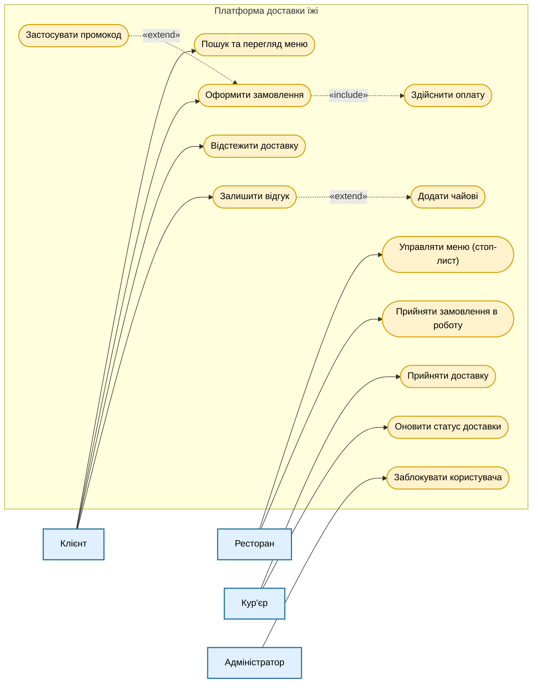
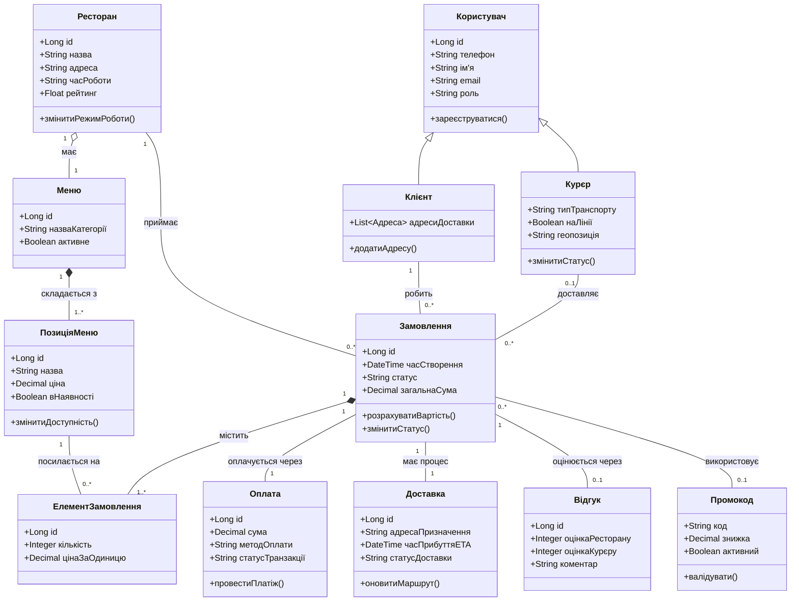
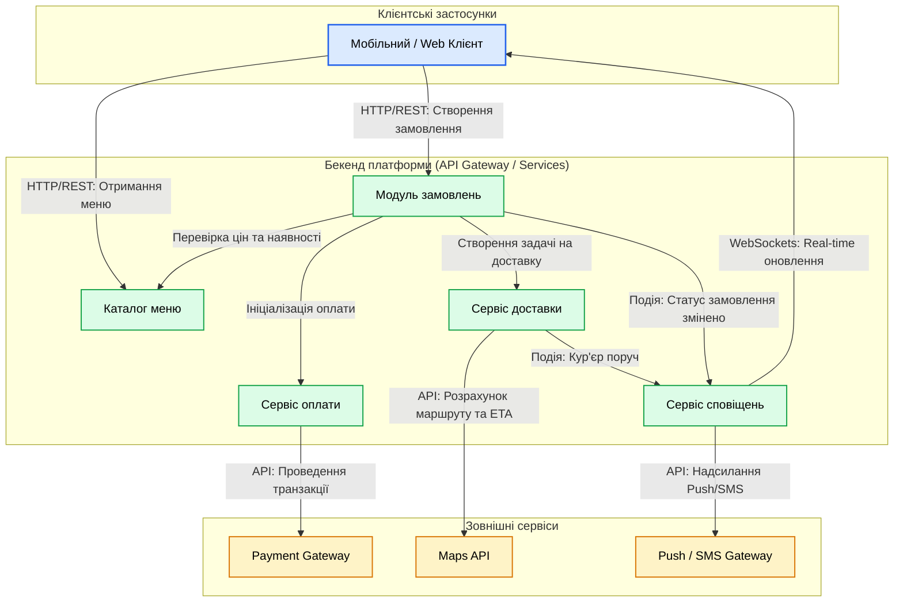

# Моделі систем та архітектура

У цьому документі представлено архітектурний опис "Платформи доставки їжі": сценарії використання (Use-Cases), доменна модель даних із поясненням зв’язків та діаграма компонентів системи.

---

## 1. Use-Case діаграма (Діаграма сценаріїв використання)

Діаграма відображає основні сценарії взаємодії користувачів із системою, а також показує зв'язки між прецедентами:
* **`<<include>>` (включає):** обов'язковий підсценарій, який завжди виконується в рамках основного сценарію.
* **`<<extend>>` (розширює):** опціональний підсценарій, який виконується лише за певних умов.

### Пояснення включених та розширених сценаріїв:
1. **`Оформити замовлення` -- `<<include>>` --> `Здійснити оплату`**: Неможливо завершити оформлення замовлення без проходження етапу оплати (або вибору/резервування методу оплати).
2. **`Застосувати промокод` -- `<<extend>>` --> `Оформити замовлення`**: Промокод застосовується клієнтом за бажанням під час оформлення замовлення (не є обов'язковим кроком).
3. **`Залишити відгук` -- `<<extend>>` --> `Додати чайові`**: При залишенні відгуку клієнт може додатково (за бажанням) залишити безготівкові чайові кур'єру.

---

## 2. Доменна модель (Діаграма класів)

Доменна модель описує ключові сутності бізнес-логіки та зв'язки між ними.

### Види зв'язків між сутностями:
* **Композиція (`*--`):** Сильна залежність. Сутність не може існувати без цілого (наприклад, `ЕлементЗамовлення` не існує без `Замовлення`, `ПозиціяМеню` не існує без `Меню`).
* **Агрегація (`o--`):** Слабша залежність. Сутність може існувати окремо (наприклад, `Ресторан` має `Меню`, але при видаленні меню ресторан продовжує існувати в системі).
* **Асоціація (`--`):** Звичайний зв'язок або посилання (наприклад, `Замовлення` посилається на `Клієнта`, `Кур'єра` та `Ресторан`).

---

## 3. Діаграма компонентів (Component Diagram)

Діаграма показує модульну структуру платформи, взаємозв'язки між внутрішніми сервісами та зовнішніми інтеграціями через визначені інтерфейси (Provided / Required interfaces).

### Пояснення модулів та інтерфейсів:

1. **Каталог меню (CatalogService):**
   * **Provided Interface:** REST API для отримання списку ресторанів, категорій та страв.
   * **Required Interface:** Внутрішній API для перевірки доступу та наявності страв іншими сервісами.

2. **Модуль замовлень (OrderService):**
   * **Provided Interface:** REST API для оформлення, скасування та перегляду історії замовлень.
   * **Required Interface:** Викликає `CatalogService` (перевірка актуальності цін), `PaymentService` (оплата) та `DeliveryService` (передача замовлення на доставку).

3. **Сервіс оплати (PaymentService):**
   * **Provided Interface:** Internal gRPC / REST API для обробки та повернення платежів.
   * **Required Interface:** HTTPS-інтеграція із зовнішніми платіжними шлюзами (`LiqPay`, `Stripe`).

4. **Сервіс доставки (DeliveryService):**
   * **Provided Interface:** REST/WebSocket API для кур'єрів (прийняття замовлення, оновлення геоданих).
   * **Required Interface:** Інтеграція з `Google Maps API` для побудови оптимізованих маршрутів та розрахунку часу доставки.

5. **Сервіс сповіщень (NotificationService):**
   * **Provided Interface:** Event Bus Listener / Async API для прийому подій від `OrderService` та `DeliveryService`.
   * **Required Interface:** Інтеграція з `Firebase Cloud Messaging` / `Twilio` для відправки Push та SMS користувачам і WebSocket-канал для real-time сповіщень.
