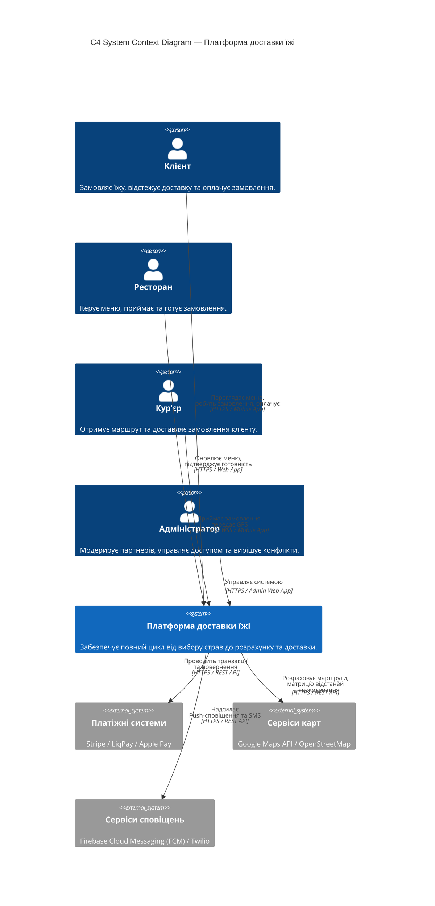
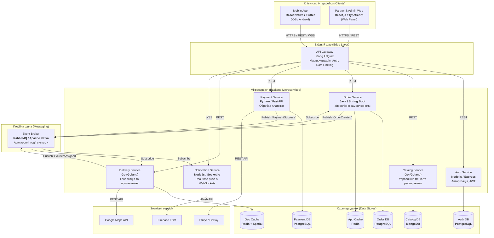

# Архітектура системи та C4-діаграми

У цьому документі розглядається вибір архітектурного стилю для "Платформи доставки їжі", його обґрунтування на основі раніше визначених архітектурних вимог (ASR), а також деталізація системи на рівнях **Context** та **Container** за методологією C4.

---

## 1. Порівняння архітектурних стилів

Для обрання оптимальної архітектури платформи було проаналізовано три класичні підходи: **Моноліт**, **Сервіс-орієнтовану архітектуру (SOA)** та **Мікросервіси**.

| Архітектурний стиль | Плюси для платформи доставки | Мінуси для платформи доставки | Вердикт |
| :--- | :--- | :--- | :--- |
| **Моноліт (Monolith)** | • Простий і швидкий старт. • Легке налаштування CI/CD та тестування. • Відсутність мережевих затримок між модулями. | • Важко масштабувати окремо пікові модулі (наприклад, тільки трекінг). • Єдина точка відмови: збій в модулі відгуків може «положити» прийом замовлень. • Уповільнення розробки при зростанні команди. | Не підходить для масштабованої системи з високими піковими навантаженнями. |
| **Сервіс-орієнтована (SOA)** | • Чіткий розподіл бізнес-доменів. • Можливість повторного використання сервісів через корпоративну шину (ESB). | • Enterprise Service Bus (ESB) стає складною єдиною точкою відмови. • Оверхед на складну інфраструктуру. • Повільніший темп релізів через загальні стандарти ESB. | Надлишково складно та негнучко для динамічного B2C/B2B маркетплейсу. |
| **Мікросервіси (Microservices)** | • Незалежне масштабування модулів (наприклад, `DeliveryService` в пікові години). • Відмовостійкість: падіння сервісу аналітики не блокує прийом грошей чи замовлень. • Незалежні технологічні стеки та команди розробки. | • Висока складність інфраструктури (DevOps, Service Mesh, Distributed Tracing). • Складніші розподілені транзакції (Saga Pattern). • Мережевий оверхед (затримки при REST/gRPC викликах). | **Оптимальний вибір** для продукту з високими вимогами до доступності та масштабування. |

---

## 2. Обґрунтування вибору мікросервісної архітектури (на основі ASR)

Вибір мікросервісної архітектури прямо спирається на 5 ключових архітектурних вимог (ASR), виділених у першій частині документації:

1. **ASR-01 (Обробка пікових навантажень) ➔ Горизонтальне autoscaling окремих сервісів**
   * *Пояснення:* Під час обіднього піку (12:00–14:00) навантаження на `CatalogService` (пошук їжі) та `DeliveryService` (трекінг GPS) зростає в десятки разів, тоді як `NotificationService` чи `ReviewService` працюють у звичайному режимі. Мікросервіси дозволяють масштабувати (Scale out) в Kubernetes лише ті контейнери, які цього потребують, не витрачаючи ресурси на всю систему.

2. **ASR-02 (Синхронізація стану в реальному часі) ➔ Подійно-орієнтована взаємодія (Event-Driven)**
   * *Пояснення:* Використання асинхронного брокера повідомлень (RabbitMQ/Kafka) між мікросервісами дозволяє передавати події на зразок `OrderCreated` чи `CourierLocationUpdated` миттєво до `NotificationService`, який транслює їх клієнту через WebSockets без блокування `OrderService`.

3. **ASR-03 (Відмовостійкість платіжного модуля) ➔ Ізоляція `PaymentService`**
   * *Пояснення:* Платіжний модуль винесено в окремий мікросервіс із власним Retry Policy, Circuit Breaker та підтримкою декількох шлюзів (Stripe, LiqPay). Збій стороннього платіжного провайдера обробляється всередині сервісу без падіння загального процесу оформлення замовлення.

4. **ASR-04 (Високоточний трекінг та геосервіси) ➔ Окреме вільне сховище для геоданих**
   * *Пояснення:* GPS-координати кур'єрів генерують величезний потік даних (High-frequency writes). В окремому мікросервісі `DeliveryService` для цього використовується in-memory БД (Redis / Redis Spatial), що усуває навантаження на основну реляційну БД замовлень.

5. **ASR-05 (Ізоляція сервісів та модульність) ➔ Незалежні бази даних (Database-per-service)**
   * *Пояснення:* Кожен мікросервіс володіє власною базою даних. Помилка у виконанні запиту чи падіння бази даних сервісу відгуків ніяк не впливає на можливість користувача замовити й оплатити їжу.

---

## 3. C4-діаграми

### 3.1. Рівень 1: C4 System Context (Контекст системи)

Діаграма відображає позиціонування платформи в зовнішньому оточенні: користувачі системи та зовнішні сторонні сервіси, з якими вона інтегрується.

---

### 3.2. Рівень 2: C4 Container Diagram (Контейнери системи)

Діаграма показує високорівневу архітектуру контейнерів (застосунків, мікросервісів, баз даних та брокерів), з яких складається платформа, а також використовувані технології.

---

### Пояснення технологічного стеку контейнерів:

1. **API Gateway (Kong / Nginx):**
   * Приймає всі вхідні запити від клієнтів, здійснює первинну авторизацію (JWT validation), обмежує кількість запитів (Rate Limiting) та маршрутизує їх на відповідні мікросервіси.

2. **Catalog Service (Go / MongoDB):**
   * Go забезпечує високу швидкість обробки запитів на читання меню. MongoDB обрано через гнучкість документо-орієнтованої структури (різні категорії страв, модифікатори, складові).

3. **Order Service (Java Spring Boot / PostgreSQL):**
   * Строго типізований та надійний стек для бізнес-критичної логіки. PostgreSQL забезпечує ACID-транзакційність для збереження цілісності замовлень.

4. **Delivery Service (Go / Redis Spatial):**
   * Redis з підтримкою гео-індексів дозволяє за мілісекунди обробляти тисячі оновлень GPS-координат від кур’єрів та знаходити найближчих виконавців.

5. **Payment Service (Python FastAPI / PostgreSQL):**
   * Легкий та простий у підтримці сервіс для інтеграції з SDK платіжних систем. Зберігає аудиторський лог усіх фінансових транзакцій у PostgreSQL.

6. **Notification Service (Node.js / Socket.io):**
   * Ідеально підходить для I/O-інтенсивного навантаження, підтримки тисяч відкритих WebSocket-з'єднань для real-time інформування клієнтів про статус доставки.

7. **Event Broker (RabbitMQ / Apache Kafka):**
   * Гарантує доставку повідомлень між мікросервісами у разі сплесків навантаження та забезпечує слабку зв'язаність (loose coupling) компонентів платформи.
