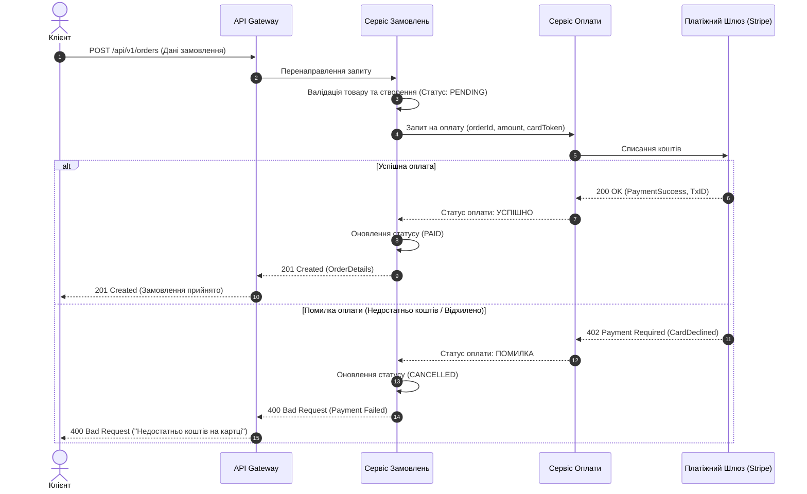
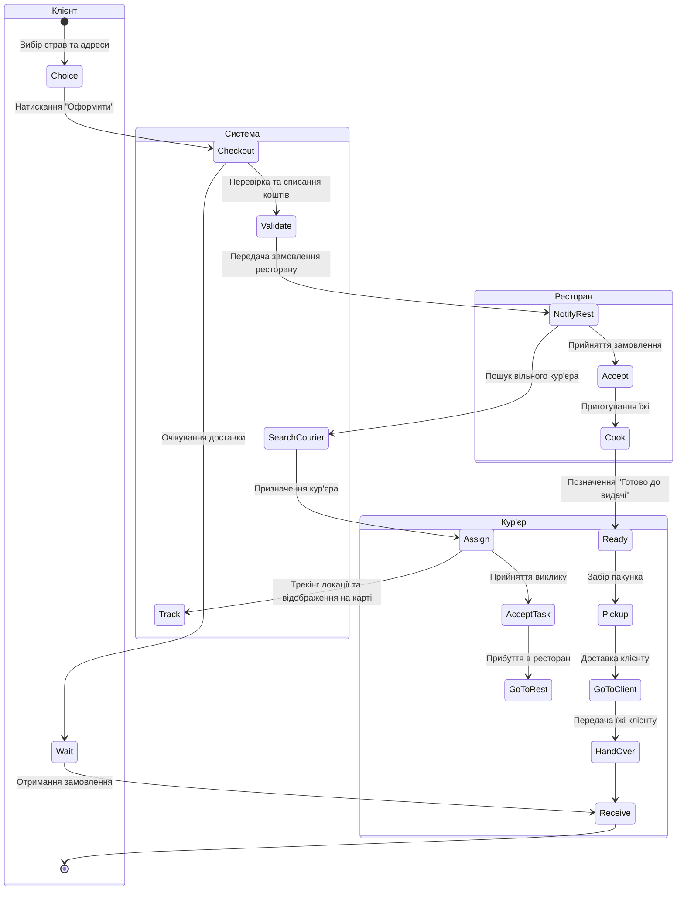
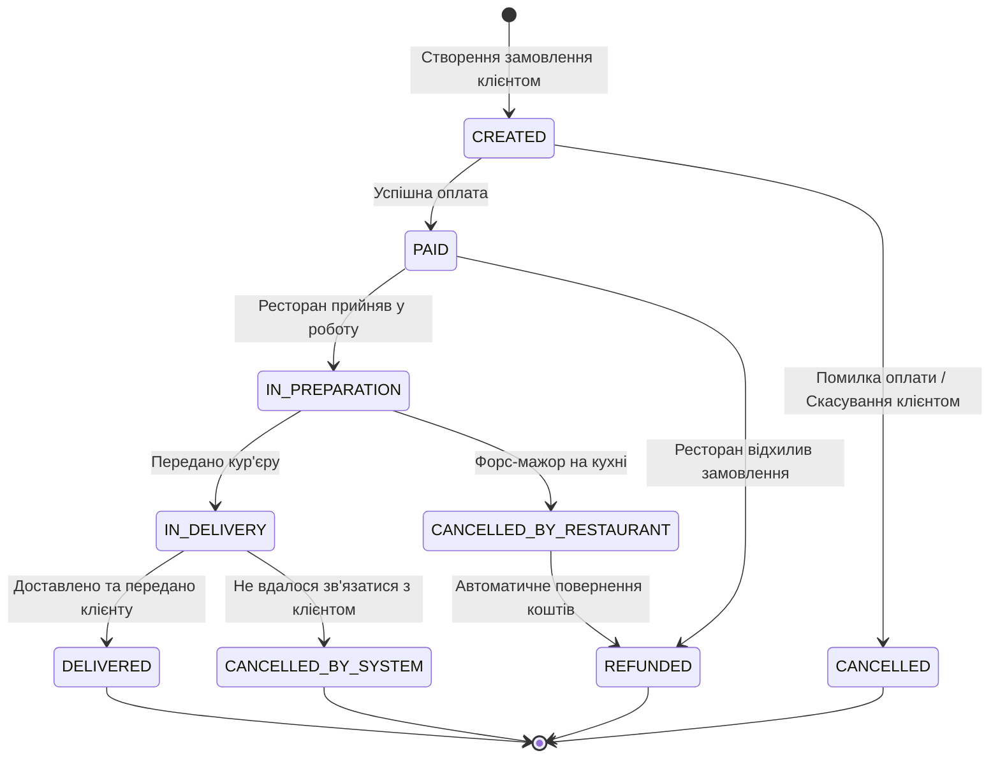
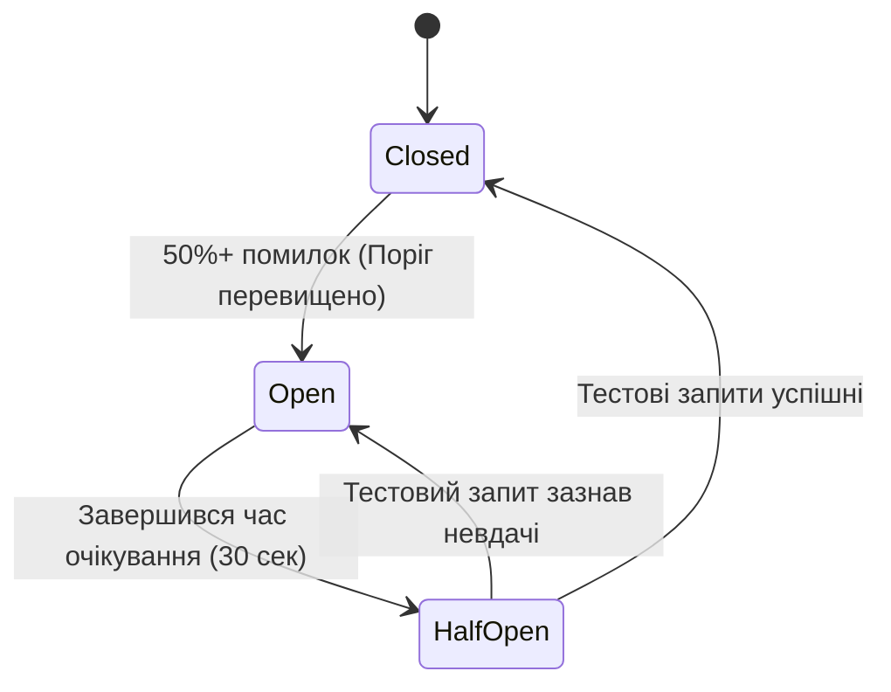

# Поведінка системи, інтеграції та паттерни надійності

У цьому документі описується динаміка роботи "Платформи доставки їжі": поведінкові діаграми (Sequence, Activity, State), типи інтеграцій між сервісами, приклади API-контрактів та паттерни забезпечення стійкості розподіленої системи (Saga, Circuit Breaker, Retry).

---

## 1. Поведінкові діаграми

### 1.1. Діаграма послідовності (Sequence Diagram): Оформлення та оплата замовлення

Діаграма демонструє взаємодію між Клієнтом, API Gateway, Сервісом замовлень, Платіжним сервісом та Зовнішнім платіжним шлюзом (Stripe/LiqPay). Розглянуто як успішний сценарій (Happy Path), так і випадок помилки (Недостатньо коштів).



---

### 1.2. Діаграма діяльності (Activity Diagram): Повний процес доставки

Діаграма показує покроковий процес доставки із розподілом відповідальності за дорожками (Swimlanes): **Клієнт**, **Система**, **Ресторан** та **Кур'єр**.



---

### 1.3. Діаграма станів (State Diagram): Сутність "Замовлення"

Сутність **Замовлення (Order)** проходить через чітко визначений життєвий цикл з 6 основних станів.



---

## 2. Опис інтеграцій (Синхронні vs Асинхронні)

В архітектурі платформи використовуються обидва типи взаємодій залежно від вимог до швидкодії та зв'язності (coupling).

### 2.1. Синхронні інтеграції (REST / gRPC)

1. **Отримання актуального меню (Клієнтський застосунок > Catalog Service)**
   * **Протокол:** REST / HTTP (JSON).
   * **Чому синхронно:** Клієнту потрібна миттєва відповідь (список страв, ціни, наявність), щоб сформувати кошик. Без цих даних подальший процес зупиняється.
2. **Проведення транзакції оплати (Payment Service > External Payment Gateway)**
   * **Протокол:** REST / HTTPS.
   * **Чому синхронно:** Сервіс повинен одразу дізнатися, чи успішно заблоковані/списані кошти, перш ніж переводити замовлення в статус "Оплачено" та відправляти на кухню.

### 2.2. Асинхронні інтеграції (Message Broker: RabbitMQ / Apache Kafka)

1. **Подія "Замовлення оплачено" (Order Service > Notification & Delivery Services)**
   * **Протокол:** AMQP / Kafka Topic (`order.events.paid`).
   * **Чому асинхронно:** Сервісу замовлень не потрібно чекати, поки сервіс сповіщень надішле Push-повідомлення або сервіс аналітики оновтить дашборд. Це дозволяє швидко віддати відповідь клієнту, а супутні задачі виконати у фоновому режимі.
2. **Оновлення геопозиції кур'єра (Courier App > Delivery Tracking Service)**
   * **Протокол:** WebSockets / MQTT або Kafka Stream.
   * **Чому асинхронно:** Координати надсилаються кожні 3–5 секунд від тисяч кур'єрів. Використання синхронних HTTP-запитів перезавантажило б вебсервери. Черга повідомлень дозволяє ефективно згладжувати високий потік даних (Backpressure).

---

## 3. Приклад API-контракту (Створення замовлення)

**Endpoint:** `POST /api/v1/orders`  
**Content-Type:** `application/json`

### 3.1. Запит (Request Payload)

```json
{
  "customerId": "usr_987654321",
  "restaurantId": "rst_12345",
  "deliveryAddress": {
    "street": "вул. Торговиця",
    "building": "17A",
    "apartment": "71",
    "city": "Тернопіль",
    "geo": {
      "lat": 49.5468,
      "lng": 25.5939
    }
  },
  "items": [
    {
      "menuItemId": "itm_margarita_30cm",
      "quantity": 2,
      "unitPrice": 250.00,
      "options": ["додатковий сир"]
    },
    {
      "menuItemId": "itm_cola_05",
      "quantity": 1,
      "unitPrice": 45.00
    }
  ],
  "paymentMethod": "CARD",
  "cardToken": "tok_visa_nonce_abcdef123456",
  "promoCode": "DISCOUNT10",
  "totalAmount": 545.00
}
```

### 3.2. Відповідь (Response Payload - 201 Created)

```json
{
  "orderId": "ord_8899001122",
  "status": "PAID",
  "createdAt": "2026-10-31T19:30:00Z",
  "estimatedDeliveryTime": "2026-10-31T20:15:00Z",
  "restaurantDetails": {
    "restaurantId": "rst_12345",
    "name": "Піца Манія"
  },
  "pricing": {
    "subtotal": 545.00,
    "discount": 54.50,
    "deliveryFee": 40.00,
    "finalTotal": 530.50
  }
}
```

---

## 4. Патерн Saga (Оркестрація)

У розподіленій мікросервісній архітектурі ми не можемо використати класичну транзакцію бази даних (ACID), оскільки кожен сервіс має власну БД. Для збереження узгодженості даних використовується **патерн Saga**.

### 4.1. Сценарій розподіленого створення замовлення

В нашій платформі **Saga Orchestrator** (Сервіс Замовлень) покроково дає команди іншим сервісам:

```
[Початок Saga] 
  ├── 1. Order Service ────> Створює замовлення зі статусом PENDING
  ├── 2. Payment Service ──> Списує кошти з картки
  ├── 3. Kitchen Service ──> Резервує інгредієнти та створює таску на кухні
  └── 4. Courier Service ──> Призначає вільного кур'єра
[Кінець Saga: Статус -> CONFIRMED]
```

### 4.2. Опрацювання помилки та компенсуючі дії

Якщо на Етапі 4 (Пошук кур'єра) виявилося, що **жодного вільного кур'єра немає** протягом 10 хвилин, запускається зворотний ланцюжок компенсацій:


| Крок | Дія (Forward Action) | Компенсуюча дія (Compensating Action) |
| :--- | :--- | :--- |
| **1. Замовлення** | Створення запису у статусі `PENDING` | Переведення у статус `CANCELLED` |
| **2. Оплата** | Списання 530.50 грн | Повернення коштів (`REFUND`) 530.50 грн |
| **3. Кухня** | Передача чека на кухонний дисплей | Відклик чека / Сповіщення "Скасовано" |
| **4. Доставка** | Запит на пошук кур'єра | Скасування пошуку |

---

## 5. Патерни надійності: Circuit Breaker та Retry

При взаємодії зі зовнішніми сервісами (наприклад, банківським платіжним шлюзом) можливі тимчасові збої або падіння мережі. Щоб система не "зависала", використовуються патерни **Circuit Breaker** та **Retry**.

### 5.1. Circuit Breaker (Автоматичний запобіжник)

#### Як працює в платіжному сервісі:
Сервіс має 3 стани:
1. **Closed (Зачинено / Все добре):** Усі запити на оплату йдуть до платіжного шлюзу.
2. **Open (Відчинено / Аварія):** Якщо 50% запитів поспіль повертають помилку 500 або Timeout, Circuit Breaker "розмикає ланцюг". Усі наступні запити на оплату **миттєво відхиляються** на стороні нашого бекенду без звернення до банку. Це рятує систему від очікування та падіння.
3. **Half-Open (Напіввідчинено):** Через 30 секунд запобіжник пропускає 1-2 тестові запити. Якщо вони пройшли успішно — система повертається в стан **Closed**. Якщо ні — залишається в **Open**.



---

### 5.2. Retry з Exponential Backoff та Jitter (Повторні спроби)

#### Як працює в коді:
Якщо платіжний шлюз повернув мережеву помилку (Network Timeout), сервіс робить повторні спроби за алгоритмом **Exponential Backoff (Експоненціальна пауза)**:

1. **Спроба 1**  > Факт: Помилка.
2. **Пауза 1 сек** > **Спроба 2** > Факт: Помилка.
3. **Пауза 2 сек** > **Спроба 3** > Факт: Помилка.
4. **Пауза 4 сек** > **Спроба 4** > Успіх!

> **Jitter (Рандомізація):** До паузи додається випадкова величина в кілька мілісекунд (наприклад, 2.13 сек замість 2.0 сек). Це робиться для того, щоб тисячі клієнтів не робили повторні запити в один і той самий мікросекундний проміжок часу, створюючи "шторм запитів" (Thundering Herd Problem).
