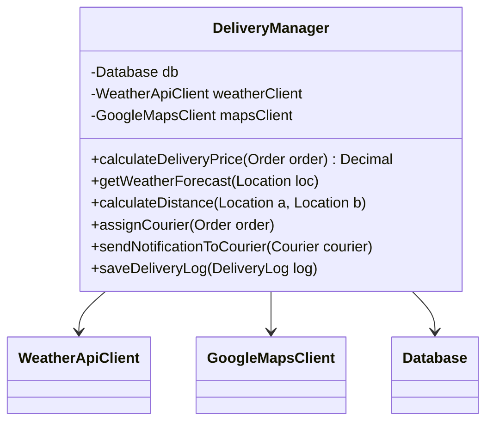
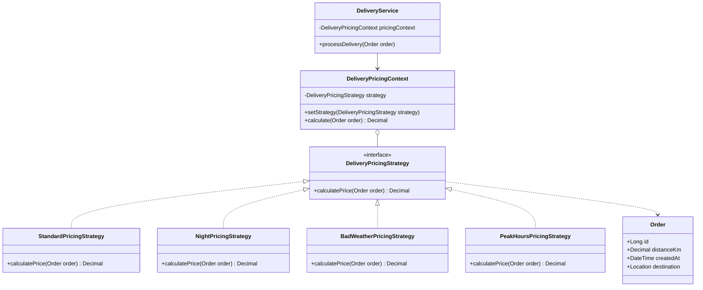
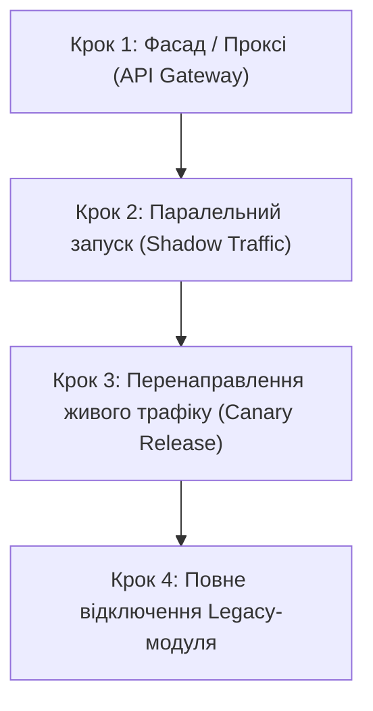

# Рефакторинг, патерни проектування та міграція

У цьому документі розглядаються проблеми якості коду у старій системі розрахунку вартості доставки, рефакторинг з анти-патерну **God Object** до GoF-патерну **Strategy**, а також безпечний план поетапної міграції за патерном **Strangler Fig**.

---

## 1. Анти-патерн "God Object" (Об'єкт-Бог)

### 1.1. Що таке God Object?
Анти-патерн **God Object** виникає, коли один клас або модуль бере на себе занадто багато відповідальностей: він зберігає всі дані, містить усю бізнес-логіку, звертається до зовнішніх сервісів і навіть формує звіти. Такий клас стає "всемогутнім", але його надзвичайно важко читати, тестувати та підтримувати.

### 1.2. Виявлення проблеми в старій системі розрахунку вартості
У старій реалізації модуля доставки існував один монолітний клас `DeliveryManager`. 

**Помилки та симптоми в `DeliveryManager`:**
1. **Порушення SRP (Single Responsibility Principle):** Клас одночасно рахує відстань, перевіряє погоду в API, розраховує знижки, надсилає сповіщення кур'єрам і розраховує тариф (базовий, нічний, погодний).
2. **Порушення OCP (Open/Closed Principle):** Щоб додати новий тариф (наприклад, "Святковий тариф" або "Доставка великогабаритного вантажу"), потрібно було змінювати код самого `DeliveryManager` через величезний ланцюжок `if-else` або `switch-case`.
3. **Висока зв'язаність (Tight Coupling) та складність тестування:** Неможливо протестувати розрахунок ціни окремо від запитів до погодного API чи баз даних.

---

## 2. Застосування GoF-патерну "Strategy" (Стратегія)

### 2.1. Просте пояснення патерну Strategy
Патерн **Стратегія** дозволяє визначити сімейство алгоритмів, помістити кожен із них у окремий клас і зробити їх взаємозамінними. 

### 2.2. Як це вирішує нашу проблему?
Ми виділяємо спільний інтерфейс `DeliveryPricingStrategy` з методом `calculatePrice(order)`. Далі створюємо окремі класи під кожний випадок:
* `StandardPricingStrategy` — розрахунок за базовим тарифом.
* `NightPricingStrategy` — розрахунок з урахуванням нічного коефіцієнта.
* `BadWeatherPricingStrategy` — розрахунок із надбавкою за складні погодні умови.
* `PeakHoursPricingStrategy` — розрахунок під час обідніх/вечірніх пікових навантажень.

Клас-контекст (`DeliveryPricingContext`) отримує потрібну стратегію під час виконання і просто викликає її метод, не переймаючись деталями реалізації.

---

## 3. Діаграми класів: ДО та ПІСЛЯ рефакторингу

### 3.1. Діаграма ДО рефакторингу (Анти-патерн God Object)

Клас `DeliveryManager` робить усе самостійно через розгалужену логіку `if/else`.

---

### 3.2. Діаграма ПІСЛЯ рефакторингу (Патерн Strategy)

Логіку розрахунку винесено в окремі стратегії. Контекст виклику оперує лише інтерфейсом.

---

## 4. План поетапної міграції за патерном "Strangler Fig" (Задушливий фікус)

### 4.1. Що таке Strangler Fig Pattern?
**Strangler Fig (Задушливий фікус)** — це стратегія міграції legacy-систем, при якій нова система створюється навколо старої й поступово перебирає на себе її функціонал крок за кроком, поки стара система повністю не перестане використовуватися та не буде видалена.

---

### 4.2. Покроковий план міграції модуля доставки

#### **Крок 1: Створення фасаду та нового мікросервісу (API Routing)**
* **Дія:** Створюється новий мікросервіс `Delivery-Service` із рефактореною логікою на основі патерну Strategy.
* **На API Gateway** додається маршрутизатор (Routing Proxy), який поки що відправляє 100% запитів на старий монолітний `DeliveryManager`.

#### **Крок 2: Паралельне виконання та порівняння результатів (Shadow Testing)**
* **Дія:** API Gateway копіює (дублює) вхідні запити:
  * Запит йде до старого `DeliveryManager` (його відповідь повертається клієнту).
  * Такий самий запит асинхронно йде до нового `Delivery-Service` (тільки для порівняння).
* **Мета:** Перевірити, що новий алгоритм розрахунку дає точно такі ж самі ціни, як і старий, не ризикуючи реальними клієнтами.

#### **Крок 3: Канарейковий реліз (Canary Release / Traffic Shifting)**
* **Дія:** Починається поетапне перенаправлення реального трафіку на новий мікросервіс:
  * **Тиждень 1:** 10% замовлень обробляються новим `Delivery-Service`.
  * **Тиждень 2:** 50% замовлень.
  * **Тиждень 3:** 100% замовлень.
* **Мета:** Відстежити моніторинг (NFR-01, NFR-03) та переконатися у відсутності помилок під навантаженням.

#### **Крок 4: Виведення з експлуатації та вилучення старого коду (Decommissioning)**
* **Дія:** Старий клас `DeliveryManager` та пов'язаний legacy-код повністю видаляються з моноліту.
* **Результат:** Міграція завершена без зупинки роботи сервісу (Zero Downtime).
