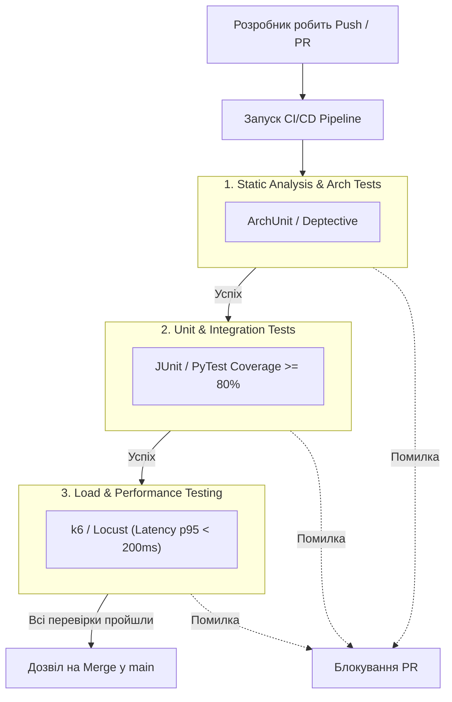

# Безпека (STRIDE) та автоматизований контроль якості (Fitness Functions)

У цьому документі описуються заходи забезпечення кібербезпеки системи на основі моделювання загроз **STRIDE**, а також автоматизовані метрики архітектурної якості (**Fitness Functions**) та їх впровадження у пайплайн безперервної інтеграції (CI/CD).

## 1. Моделювання загроз за методологією STRIDE

Методологія **STRIDE** використовується для системного аналізу безпеки шляхом перевірки точок системи на 6 категорій загроз:

* **S**poofing (Підробка особи/токена)
* **T**ampering (Підміна або фальсифікація даних)
* **R**epudiation (Заперечення авторства дій)
* **I**nformation Disclosure (Витік конфіденційних даних)
* **D**enial of Service (Відмова в обслуговуванні через перевантаження)
* **E**levation of Privilege (Несанкціоноване підвищення привілеїв)

### Зведена таблиця ризиків та контрзаходів

| Точка системи | Категорія STRIDE | Опис загрози (Простими словами) | Заходи захисту (Контрзаходи) |
| ----- | ----- | ----- | ----- |
| **1. Вхідний API-шлюз (API Gateway)** | **Spoofing** | Зловмисник підробляє токен доступу (JWT) і робить запити від імені іншого клієнта. | Сувора перевірка підпису JWT з використанням asymmetric keys (RS256) та короткий строк дії access-токена (15 хв). |
| | **Denial of Service** | Хтось запускає ботнет і надсилає мільйони запитів на хвилину, завалюючи систему. | Впровадження **Rate Limiting** (наприклад, макс. 100 запитів/хв з однієї IP/акаунта) та Web Application Firewall (WAF). |
| | **Elevation of Privilege** | Клієнт змінює ID у запиті та отримує доступ до адмін-панелі. | Рольова модель доступу (RBAC) та валідація прав доступу на рівні Gateway для кожного маршруту. |
| **2. Сервіс обробки платежів** | **Tampering** | Зловмисник перехоплює запит і змінює суму замовлення з 500 грн на 5 грн перед відправкою у банк. | Цифровий підпис (HMAC-SHA256) усіх платіжних параметрів та звірка підсумкової суми на бекенді. |
| | **Information Disclosure** | Витік даних банківських карток користувачів під час передачі чи збереження. | Використання TLS 1.3 для передачі, заборона збереження CVV/PAN даних в БД (відповідність PCI DSS), токенізація карт. |
| | **Repudiation** | Користувач стверджує, що не робив замовлення і вимагає повернення коштів. | Повне логування фінансових транзакцій із незмінними мітками часу (Audit Log) у захищеному сховищі. |
| **3. Сервіс геолокації кур'єра** | **Spoofing** | Шкідливий застосунок підробляє GPS-координати кур'єра, щоб отримати бонуси за вигадану доставку. | Перевірка GPS-даних на стороні сервера (наприклад, аналіз реалістичності швидкості переміщення кур'єра). |
| | **Information Disclosure** | Зловмисник стежить за переміщенням усіх кур'єрів платформи у реальному часі. | Доступ до геопозиції конкретного кур'єра надається тільки клієнту зі зв'язаним активним замовленням. |
| | **Denial of Service** | Кур'єрський застосунок надсилає координати 100 разів на секунду, перевантажуючи базу даних. | Throttle-оптимізація клієнта (відправка не частіше ніж 1 раз на 3-5 сек) та асинхронний прийом через чергу (RabbitMQ). |

---

## 2. Метрики якості (Fitness Functions)

**Fitness Functions (Функції відповідності)** — це автоматизовані перевірки, які гарантують, що архітектура системи з часом не деградує та відповідає нефункціональним вимогам (NFR).

### 2.1. Метрика 1: Час відгуку API (Performance Benchmark)
* **Ціль:** Час відгуку 95% REST API ендпоінтів (p95 latency) не повинен перевищувати **200 мс** під припустимим навантаженням.
* **Навіщо:** Забезпечує виконання нефункціональної вимоги NFR-01 (швидкодія та комфорт клієнтів).

### 2.2. Метрика 2: Архітектурна чистота (Відсутність циклічних залежностей)
* **Ціль:** Заборона прямого виклику між сервісами по колу (наприклад, `Order Service` > `Delivery Service` > `Order Service`) та заборона імпорту модулів нижчого рівня у вищі.
* **Навіщо:** Зберігає мікросервіси насправді незалежними, запобігає утворенню "розподіленого моноліту" та полегшує підтримку коду.

### 2.3. Метрика 3: Покриття коду тестами (Code Coverage)
* **Ціль:** Покриття бізнес-логіки юніт- та інтеграційними тестами має бути **не менше ніж 80%**.
* **Навіщо:** Запобігає появі багів при проведенні рефакторингу чи додаванні нових фіч.

---

## 3. Автоматизація перевірок у CI/CD Пайплайні

Усі три метрики перевіряються автоматично при кожному висуванні коду (Push / Pull Request) у репозиторій за допомогою **GitHub Actions** або **GitLab CI**.

### Принцип роботи:

1. **Крок 1: Перевірка архітектури (ArchUnit):**
   * Під час збірки проєкту спеціальний інструмент (наприклад, *ArchUnit* для Java або *Import-Linter* для Python) аналізує імпорти у коді.
   * Якщо хтось із розробників випадково створив циклічну залежність між мікросервісами, збірка **падає з помилкою**.

2. **Крок 2: Перевірка тестами та аналіз покриття (Coverage):**
   * Запускаються всі юніт-тести.
   * Інструмент (наприклад, *JaCoCo* або *coverage.py*) підраховує відсоток виконаних рядків коду. Якщо покриття становить, наприклад, 76% (менше 80%), CI/CD блокує внесення змін.

3. **Крок 3: Автоматичне нагрузочне тестування (k6 / Locust):**
   * У тимчасовому тестовому середовищі (Staging) піднімаються сервіси.
   * Скрипт (наприклад, *k6*) симулює роботу 500 одночасних користувачів протягом 1 хвилини.
   * Якщо середня затримка відповіді API перевищує 200 мс, система сповіщає про деградацію продуктивності та відхиляє оновлення.
